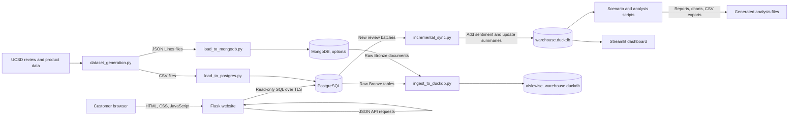
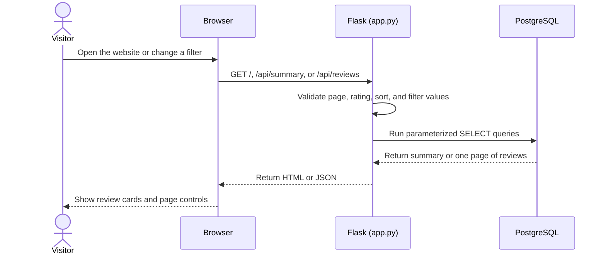
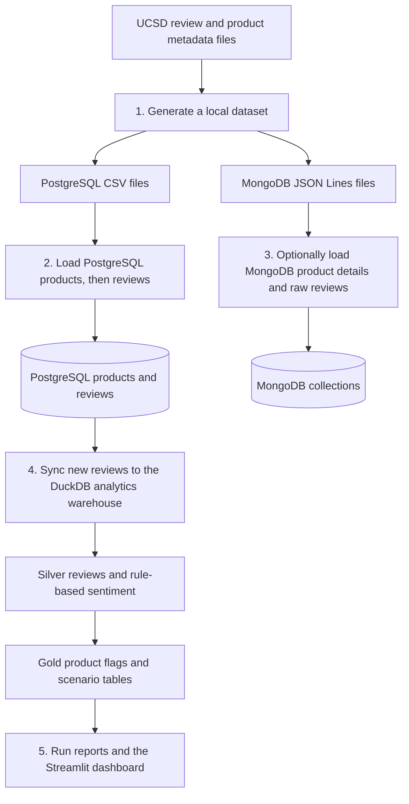

# Aislewise

## Product review intelligence

Aislewise is a review-analysis project with two separate apps:

1. A **Flask website** that searches and displays all product reviews stored in PostgreSQL.
2. A **Streamlit dashboard** that explores review sentiment and product-quality scenarios from a DuckDB analytics file.

The website and the dashboard use different data paths. The Flask website reads PostgreSQL when someone visits it. The Streamlit dashboard reads a local `warehouse.duckdb` snapshot. The dashboard does not connect to PostgreSQL by itself.

> **Important: know what this project contains.** The current analytics snapshot has 50,000 review records, including review text and reviewer IDs. Check dataset permissions and privacy requirements before sharing this repository or dashboard publicly. Keeping a GitHub repository private does not automatically make a separately published dashboard private.

> **Project scope:** This repository analyzes product reviews. It does not currently implement an online store, shopping cart, wishlist, order management, real checkout, or payment processing. The commerce and sales features described in some sample project plans are not part of this application.

## What users can do

### Flask review website

- View review and product counts, average rating, and verified-purchase percentage.
- Search product IDs, product names, review titles, and review text.
- Filter by star rating and verified-purchase status.
- Sort by newest, oldest, rating, or helpful votes.
- Browse results 20, 50, or 100 reviews at a time.

### Streamlit analytics dashboard

- View overall review and product counts.
- Investigate Scenario A rating traps.
- Investigate Scenario B hidden gems.
- Review Scenario C low-rated products with many negative reviews.
- Search for a product ID and inspect its customer reviews.
- Download the Scenario C list as a CSV.

## Architecture



### How the website request works



The Flask website only reads from PostgreSQL. It does not upload reviews or create, edit, or delete database records. Search values are passed as SQL parameters, and sort choices come from a fixed allowlist.

## Technology

| Part | Technology | Purpose |
|---|---|---|
| Website | Flask and Python | Serve the page and review API |
| Browser interface | HTML, CSS, JavaScript | Display reviews, filters, and pagination |
| Website database | PostgreSQL | Store products and customer reviews |
| Analytics database | DuckDB | Store the local analysis snapshot and derived tables |
| Analytics interface | Streamlit | Explore the DuckDB review analysis |
| Charts | Plotly, Matplotlib, and Seaborn | Display or export charts |
| Website hosting | Vercel | Host the Flask website and API |
| Dashboard hosting | Streamlit Community Cloud | Host the separate Streamlit app |
| Source control and CI | GitHub and GitHub Actions | Store code and run automated tests |

## Review data and database tables

### PostgreSQL source tables

`load_to_postgres.py` creates these tables if they do not already exist:

| Table | What one row represents | Main fields |
|---|---|---|
| `products` | One product | `product_id`, `title`, `main_category`, `average_rating`, `rating_number`, `price`, `store` |
| `reviews` | One customer review | `review_id`, `product_id`, `user_id`, `rating`, `title`, `text`, `timestamp`, `verified_purchase`, `helpful_vote` |

Each `reviews.product_id` references `products.product_id`. Load product rows before review rows.

The website reads from these PostgreSQL tables. Set `DATABASE_URL` for the Flask website. The existing ingestion and synchronization scripts use `NEON_DATABASE_URL`.

### DuckDB analytics tables

`warehouse.duckdb` is the dashboard's local snapshot. Its main tables include:

| Table | What it contains |
|---|---|
| `silver_reviews` | Review fields plus a rule-based `sentiment` value |
| `gold_product_discrepancy_flags` | Per-product review counts, ratings, sentiment percentages, and Scenario A/B flags |
| `gold_scenario_b_forensics` | Extra analysis of Scenario B products |
| `gold_scenario_c_catalog_purge` | Products meeting the Scenario C criteria |
| Other `gold_*` tables | Extra scenario, durability, complaint, and review-velocity results |

The snapshot currently has **50,000 reviews** across **15,641 products**. In the current snapshot, sentiment counts are 41,343 positive, 7,054 negative, and 1,603 neutral. Snapshot counts describe the file included with the project; they can differ from live PostgreSQL counts.

### Scenario rules

The scenario scripts use these thresholds:

- **Scenario A — Rating traps:** average product rating is at least 4.0, but at least 35% of the product's reviews are classified negative.
- **Scenario B — Hidden gems:** average product rating is at most 3.0, while at least 65% of its reviews are classified positive.
- **Scenario C — Catalog lemons:** average product rating is at most 2.5, while at least 60% of its reviews are classified negative.

The sentiment classifier in `incremental_sync.py` uses a small word list and the star rating. It is a simple heuristic, not a trained language model or a verified judgment of customer intent. Read original reviews before making business decisions.

## Project structure

```text
Aislewise/
├── app.py                       # Flask website, PostgreSQL connection, and JSON API
├── public/
│   └── static/
│       ├── css/styles.css       # Website layout and responsive styles
│       └── js/reviews.js        # Browser search, filters, and pagination
├── templates/
│   └── index.html               # Website HTML
├── streamlit/
│   ├── app.py                   # Streamlit review-analysis dashboard
│   └── requirements.txt         # Dashboard dependencies
├── .streamlit/
│   └── config.toml              # Shared Streamlit theme
├── tests/
│   ├── test_app.py              # Website and API tests
│   └── test_streamlit_app.py    # Dashboard startup test
├── Scenario_A/                  # Rating-trap investigations and supplier notices
├── Scenario_B/                  # Hidden-gem investigations
├── Scenario_C/                  # Poor-rating product audits
├── warehouse.duckdb             # Dashboard's 50,000-review analytics snapshot
├── aislewise_warehouse.duckdb   # Local Bronze-ingestion database, if generated
├── dataset_generation.py        # Fetch reviews and matching product metadata
├── load_to_postgres.py          # Load generated CSVs into PostgreSQL
├── load_to_mongodb.py           # Optional MongoDB loader
├── ingest_to_duckdb.py          # Copy PostgreSQL/MongoDB data to Bronze tables
├── incremental_sync.py          # Sync PostgreSQL reviews to DuckDB and classify
├── run_analysis.py              # Portfolio summaries and overview chart
├── deep_investigation_suite.py   # Root-cause and verification analyses
├── export_analysis.py           # Export selected summaries to CSV and JSON
├── requirements.txt             # Flask/Vercel dependencies
├── requirements-analysis.txt    # Data and analysis dependencies
├── requirements-dev.txt         # Test dependencies
├── vercel.json                  # Vercel Flask function settings
└── README.md
```

## Data pipeline: from source reviews to analysis



### Step 1: Generate input files (optional)

`dataset_generation.py` downloads a set of reviews and matching product metadata from the configured public dataset URLs. It writes CSV files under `data_postgresql/` and JSON Lines files under `data_mongodb/`.

Run this only if you intend to fetch a new dataset:

```powershell
python dataset_generation.py
```

The command needs an internet connection and can take time. It generates local input data; it does not deploy the website.

### Step 2: Load PostgreSQL (optional)

`load_to_postgres.py` creates the `products` and `reviews` tables if needed, imports products first, then copies review records in batches, and prints database counts.

```powershell
python load_to_postgres.py
```

It reads `data_postgresql/products_table.csv` and `data_postgresql/reviews_table.csv` and uses `NEON_DATABASE_URL`.

> **Do not blindly rerun the PostgreSQL loader on an already-populated database.** It does not provide an upsert/reset workflow for existing primary keys. Confirm the target database and decide how to handle existing rows before loading again.

### Step 3: Load MongoDB (optional)

`load_to_mongodb.py` loads the generated JSON Lines files and creates indexes:

```powershell
python load_to_mongodb.py
```

> **Destructive action:** the current MongoDB loader drops its `product_details` and `raw_reviews` collections before it imports data. Use it only with a disposable development database or after you have a verified backup. MongoDB is not required by the Flask website or Streamlit dashboard.

### Step 4: Copy source rows to Bronze tables (optional)

`ingest_to_duckdb.py` reads PostgreSQL and MongoDB and writes raw Bronze tables into a separate file named `aislewise_warehouse.duckdb`:

```powershell
python ingest_to_duckdb.py
```

This is not the analytics database used by `streamlit/app.py`. It requires both database connections and does not create the Silver and Gold dashboard tables.

### Step 5: Sync reviews into the analytics warehouse

`incremental_sync.py` connects to PostgreSQL using `NEON_DATABASE_URL`, reads new review batches, adds a rule-based sentiment label, and updates DuckDB Silver/Gold review tables.

```powershell
python incremental_sync.py
```

This script runs continuously until stopped with `Ctrl+C`. It writes to `warehouse.duckdb` in the current working directory. Stop it before copying or replacing that database file.

### Step 6: Run analysis and export results

Run these scripts from the project root and only after their required DuckDB tables exist:

```powershell
python run_analysis.py
python deep_investigation_suite.py
python Scenario_A/scenario_a_trap_products.py
python Scenario_B/scenario_b_base_detection.py
python Scenario_B/scenario_b_deep_forensics.py
python Scenario_C/scenario_c_audit.py
python export_analysis.py
```

They print analysis results and can update DuckDB analysis tables or generate reports and charts in the scenario folders. `export_analysis.py` writes summary CSV and JSON files into `analytics_exports/`. These are local analysis steps, not required to run the Flask website.

## Run locally on Windows

### 1. Open a terminal in the project root

```powershell
cd C:\path\to\Aislewise
```

### 2. Create and activate a Python environment

```powershell
python -m venv .venv
.\.venv\Scripts\Activate.ps1
```

If PowerShell prevents environment activation, either allow local scripts according to your organization's policy or run `.venv\Scripts\python.exe` directly in the commands below.

### 3. Install dependencies

For just the Flask website:

```powershell
python -m pip install -r requirements.txt
```

For the website, analytics scripts, Streamlit dashboard, and tests:

```powershell
python -m pip install -r requirements-analysis.txt -r requirements-dev.txt -r streamlit/requirements.txt
```

### 4. Configure the local PostgreSQL connection

Copy the example environment file and add your own connection URLs:

```powershell
Copy-Item .env.example .env
```

Set these values inside your local, untracked `.env` file:

```dotenv
DATABASE_URL=your-postgresql-connection-url
NEON_DATABASE_URL=your-postgresql-connection-url
```

`DATABASE_URL` is used by the website. `NEON_DATABASE_URL` is used by the existing PostgreSQL loader and DuckDB sync script. For a hosted PostgreSQL service, use its SSL-enabled connection string. Never paste a real connection URL into README, source code, or a public GitHub repository.

### 5. Start the Flask review website

```powershell
python app.py
```

Open <http://127.0.0.1:5000>. To stop the local server, press `Ctrl+C`.

Useful URLs:

| URL | Result |
|---|---|
| `http://127.0.0.1:5000/` | Review website |
| `http://127.0.0.1:5000/health` | PostgreSQL connectivity check |
| `http://127.0.0.1:5000/api/summary` | Review and product totals |
| `http://127.0.0.1:5000/api/reviews?page=1&page_size=20` | First page of reviews |
| `http://127.0.0.1:5000/api/reviews?q=ice&rating=5` | Search for “ice” and filter to five stars |

If the page loads but the counts fail, check `/health`, the `.env` URLs, network access, and that both PostgreSQL tables exist.

### 6. Start the Streamlit dashboard

Open a second terminal in the project root and run:

```powershell
python -m streamlit run streamlit/app.py
```

Streamlit opens its local dashboard URL in a browser. The dashboard reads `warehouse.duckdb` from the project root and does not need the PostgreSQL connection to display its saved snapshot.

## Deploy the Flask website to Vercel

Vercel hosts the **Flask website and API only**. It does not run the Streamlit dashboard or use the local DuckDB snapshot for website requests.

### 1. Push the project to GitHub

Create a GitHub repository for this project. A private repository is recommended because the DuckDB snapshot contains the full review records. Then, from the project root:

```powershell
git status --short
git remote add origin https://github.com/YOUR-USERNAME/Aislewise.git
git add .
git commit -m "Prepare Aislewise deployment"
git push -u origin main
```

If the project already has an `origin` remote, update it with `git remote set-url origin https://github.com/YOUR-USERNAME/Aislewise.git` instead of adding it again.

Before pushing, make sure `.env`, `.streamlit/secrets.toml`, `.vercel/`, `aislewise_warehouse.duckdb`, and generated CSV files are not tracked. `.env.example` contains placeholders only and is safe to share.

### 2. Import the repository in Vercel

1. In Vercel, choose **Add New → Project**.
2. Import the GitHub repository.
3. Keep the project root set to the repository root.
4. Add `DATABASE_URL` under the Vercel project's Environment Variables for the environments you want to deploy.
5. Use the SSL-enabled PostgreSQL URL. Do not add a connection URL to `vercel.json` or commit it to GitHub.
6. Deploy the project.

Vercel detects the root `app.py` as the Flask application. The templates are included with the serverless function, and files under `public/` are served as static assets. The Flask app also serves those same assets locally from `public/static/`.

For a deployment straight from your local computer instead of GitHub, open PowerShell in the project root and run `npx vercel login`, then `npx vercel link`, then `npx vercel`. Sign in through the browser opened by the CLI; do not paste an access token into chat or put it in a source file. The `.vercelignore` file prevents local credentials, DuckDB files, and generated datasets from being uploaded by the CLI. After linking, set `DATABASE_URL` in that Vercel project's Environment Variables before testing the deployed review API.

### 3. Verify the Vercel deployment

After deployment, visit:

- `/` to check the review website.
- `/health` to check the PostgreSQL connection.
- `/api/summary` to check live PostgreSQL totals.

The website uses serverless requests. It does not require the local DuckDB files.

## Deploy the Streamlit dashboard to Community Cloud

The Streamlit dashboard is a separate deployment from Vercel:

1. Push the project to GitHub and confirm the repository includes `warehouse.duckdb`.
2. In Streamlit Community Cloud, choose **Create app** and connect the repository.
3. Select branch `main`.
4. Set the app file to `streamlit/app.py`.
5. Deploy the app.

Community Cloud finds the dashboard's dependencies in `streamlit/requirements.txt` and the shared theme in `.streamlit/config.toml`. The Streamlit app uses the checked-in DuckDB snapshot, so it does not require `DATABASE_URL` to display the snapshot.

> **Snapshot update:** Streamlit reads the committed database file, not live PostgreSQL. To update the dashboard data, refresh `warehouse.duckdb` locally, run the tests, and commit/push the updated file. A public Streamlit app can expose data in that snapshot to its viewers.

## GitHub Actions and tests

`.github/workflows/tests.yml` runs tests for pushes and pull requests.

Run the same tests locally:

```powershell
python -m pip install -r requirements-dev.txt -r streamlit/requirements.txt
python -m pytest -q
```

The tests cover:

- Flask homepage and static assets.
- Summary and review API behavior.
- Search, product, rating, verified-purchase, sorting, and pagination filters.
- Clear errors for invalid input or missing database configuration.
- Streamlit dashboard startup using `warehouse.duckdb`.
- Live PostgreSQL connectivity and read-only review checks when a database URL is configured.

The live PostgreSQL test is skipped when `DATABASE_URL` and `NEON_DATABASE_URL` are not set. Do not add database credentials to GitHub Actions unless you intentionally want it to connect to a real database.

## Common problems

| Problem | Check |
|---|---|
| `python app.py` exits immediately | Run the command from the project folder and check that `app.py` contains the direct-run entry point. |
| Website says PostgreSQL is unavailable | Check `.env`, `DATABASE_URL`, the SSL setting, network access, and the PostgreSQL tables. |
| Review counts fail but the homepage opens | The HTML can load without database access; check `/health`. |
| Streamlit says the DuckDB file is missing | Start Streamlit from the repository root and make sure `warehouse.duckdb` exists there. |
| Scenario script reports a missing table | Run the data/sync steps needed to build its DuckDB inputs first. |
| Vercel page opens but API returns 503 | Add `DATABASE_URL` in the Vercel project settings and redeploy. |
| MongoDB data unexpectedly disappeared | The MongoDB loader drops target collections before loading; restore from backup and do not rerun it against important data. |

## Known limitations

- Website review data is read from live PostgreSQL; dashboard analysis uses a separate, committed DuckDB snapshot.
- Streamlit's refresh control reruns the dashboard but does not synchronize PostgreSQL into DuckDB.
- The sentiment labels use simple rating and keyword rules and can be wrong.
- Re-running the initial PostgreSQL import is not an automatic upsert operation.
- The MongoDB loader currently drops its destination collections before import.
- Scenario recommendations are investigative signals; validate the original reviews before acting.
# Aislewise-2

