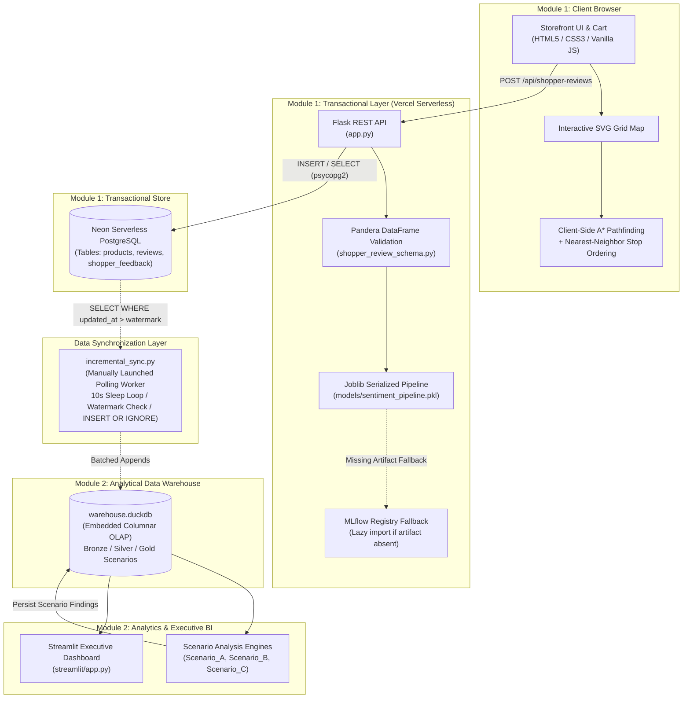
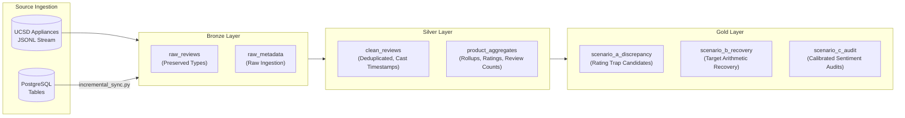
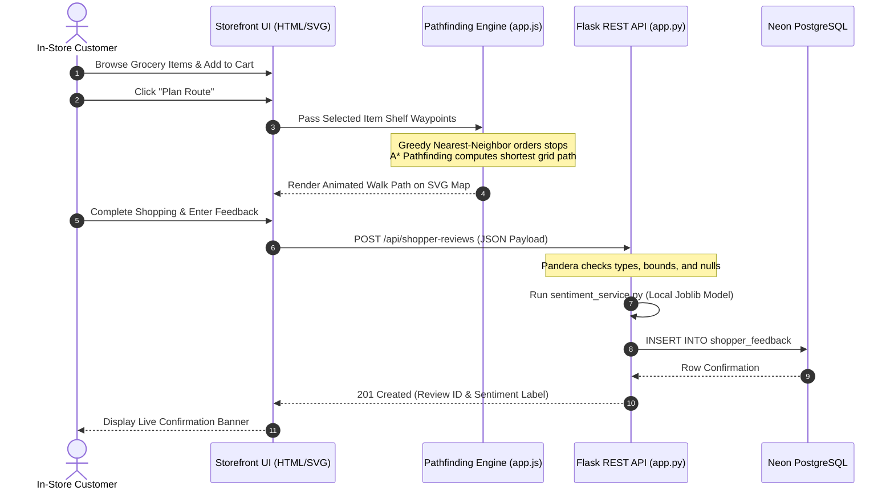

```mermaid
flowchart TD
    subgraph Training_Phase ["Offline Model Lifecycle"]
        RawCorpus["Curated Review Text\n(Amazon Appliances Corpus)"]
        TFIDF["TF-IDF Vectorizer\n(ngram_range=(1,2), max_features=10000)"]
        Classifier["Logistic Regression\n(Binary: Positive vs Negative)"]
        Calibrator["CalibratedClassifierCV\n(Platt Scaling / Sigmoid Probabilities)"]
        MLflow["MLflow Experiment Tracking\n(Parameters, Metrics, Artifacts)"]
        JoblibExport["Joblib Serialization\n(models/sentiment_pipeline.pkl)"]

        RawCorpus --> TFIDF --> Classifier --> Calibrator
        Calibrator --> MLflow
        Calibrator --> JoblibExport
    end

    subgraph Runtime_Phase ["Inference Execution (sentiment_service.py)"]
        InboundText["Input Review String\n(API or Streamlit)"]
        ArtifactCheck{"models/sentiment_pipeline.pkl\nExists on Local Disk?"}
        LoadJoblib["joblib.load()\nFast In-Memory Scorer"]
        ImportMLflow["Lazy Import MLflow\nDownload from Model Registry"]
        EvaluateText{"Text Empty or\nLow Confidence?"}
        HeuristicFallback["Rating Heuristic Fallback\n(Star <= 2: Negative, Star >= 4: Positive)"]
        ModelOutput["Calibrated Sentiment & Score\n(Positive / Negative / Neutral)"]

        InboundText --> ArtifactCheck
        ArtifactCheck -->|Yes| LoadJoblib
        ArtifactCheck -->|No| ImportMLflow
        LoadJoblib --> EvaluateText
        ImportMLflow --> EvaluateText
        EvaluateText -->|Insufficient Features| HeuristicFallback
        EvaluateText -->|Valid Signal| ModelOutput
        HeuristicFallback --> ModelOutput
    end
```

# Aislewise: Dual-Domain In-Store Navigation & Review Intelligence

[](https://productreviewintelligence.vercel.app)
[](https://aislewise-2-4iv34qn38dgv3q7npfggyv.streamlit.app/)
[](https://www.python.org/)
[](https://neon.tech/)
[](https://duckdb.org/)
[](https://scikit-learn.org/)
[](LICENSE)

Aislewise is a full-stack, dual-domain retail engineering platform demonstrating decoupled transactional (OLTP) and analytical (OLAP) workflows. The project pairs an in-browser grocery routing storefront with an offline forensic review intelligence engine evaluated against the UCSD Amazon Reviews 2023 dataset.

---

## 1. Executive Overview & Domain Separation

Aislewise explicitly isolates transactional operations from analytical investigations across two distinct functional domains:

* **Module 1 — In-Store Grocery Navigation & Shopper Telemetry (OLTP):**
  * A client-side, zero-build web interface (HTML5, CSS3, Vanilla JavaScript, inline SVG).
  * Implements dynamic A* pathfinding and nearest-neighbor multi-stop wayfinding across a grocery aisle grid.
  * Ingests shopper checkout telemetry, dwell times, and in-store feedback into a Neon PostgreSQL database validated via Pandera runtime schemas.
* **Module 2 — Product Review Intelligence & Forensic Auditing (OLAP):**
  * Ingests, cleanses, and structures UCSD Amazon Reviews 2023 (Appliances category) data across Bronze, Silver, and Gold relational tables in DuckDB.
  * Implements forensic detection algorithms across three investigative scenarios (rating-sentiment discrepancy, rating recovery arithmetic, and NLP semantic audit).
  * Exposes interactive data exploration and model diagnostics through an executive Streamlit dashboard.

> **Operational Boundary:** The Amazon Appliances review corpus and the in-store grocery catalog operate on independent schemas and data lifecycles. Amazon Appliances records do not populate the physical grocery storefront shelves, and submitted shopper feedback is not automatically replicated into DuckDB analytics without explicitly launching the manual polling synchronization worker.

---

## 2. Live Deployments

| Component | Platform | Live URL |
| :--- | :--- | :--- |
| **Storefront & Navigation** | Vercel Serverless | [https://productreviewintelligence.vercel.app](https://productreviewintelligence.vercel.app) |
| **Executive BI Dashboard** | Streamlit Community Cloud | [https://aislewise-2-4iv34qn38dgv3q7npfggyv.streamlit.app/](https://aislewise-2-4iv34qn38dgv3q7npfggyv.streamlit.app/) |
| **Source Code Repository** | GitHub | [https://github.com/poruri-santhosh/Aislewise-2](https://github.com/poruri-santhosh/Aislewise-2) |

---

## 3. High-Level System Architecture



---

## 4. Technology Stack

| Layer | Technologies | Implementation Role |
| :--- | :--- | :--- |
| **Front-End & Wayfinding** | Vanilla HTML5, CSS3, JavaScript, SVG DOM | Coordinate layout, real-time cart state, zero-build client execution. |
| **Pathfinding Algorithms** | A* Graph Search, Greedy Nearest-Neighbor | In-browser aisle routing, coordinate waypoint traversal, order heuristic. |
| **Web & API Framework** | Python 3.12+, Flask 3.1, Gunicorn 23.0 | REST endpoints, JSON payload handling, serverless Lambda execution. |
| **Schema Validation** | Pandera 0.35 | Runtime DataFrame schema contract validation, bounds, and null checks. |
| **Transactional Database (OLTP)** | PostgreSQL (Neon Serverless), psycopg2-binary | Relational persistence, transactional safety, shopper feedback storage. |
| **Analytical Warehouse (OLAP)** | DuckDB 1.5 | In-process columnar processing, analytical SQL queries, scenario staging. |
| **Machine Learning & NLP** | scikit-learn 1.9, Joblib, TF-IDF Vectorizer | Logistic Regression classification, Platt confidence calibration. |
| **Experimentation & Tracking** | MLflow 3.18 | Offline model tracking, parameter logging, and registry fallback integration. |
| **Analytics Dashboard (BI)** | Streamlit 1.66, Plotly, Pandas | Metric filtering, forensic data drill-down, distribution visualizers. |

---

## 5. Dataset Provenance & Data Engineering Lifecycle

### Dataset Specifications
* **Source:** UCSD Amazon Reviews 2023 (Julian McAuley Lab).
* **Category:** Appliances (`Appliances.jsonl.gz`) matched with metadata (`meta_Appliances.jsonl.gz`).
* **Ingestion Strategy:** Streamed HTTP extraction via `urllib.request` and `gzip.GzipFile` line-by-line parsing to eliminate memory spikes.
* **Volume:** Ingestion of up to 50,000 review records and matching parent ASIN metadata.
* **Cleaning & Type Conversion (`dataset_generation.py`):**
  * Type-casting and fallback handling via `safe_float()` and `safe_int()`.
  * Generates sequential review identifiers (`rev_1`, `rev_2`, ...) while preserving user text, verified purchase flags, and timestamps.
  * Discards records with missing parent ASIN keys.

### Medallion Layering in DuckDB


### Incremental Synchronization Architecture (`incremental_sync.py`)
Synchronization between Neon PostgreSQL and DuckDB is implemented as a **manually launched, continuously polling worker**:
* **Polling Loop:** Executes an explicit `while True` loop with a 10-second sleep (`time.sleep(10)`) when no new rows are returned.
* **Watermark Extraction:** Queries PostgreSQL incrementally using updated timestamps (`WHERE updated_at > %s ORDER BY updated_at ASC LIMIT %s`).
* **DuckDB Deduplication:** Applies `INSERT OR IGNORE INTO <table_name> VALUES (...)` against unique constraints.
* **Operational Scope:** Runs on-demand; it is not an automated continuous CDC engine or background cron scheduler.

---

## 6. Machine Learning Lifecycle: Sentiment Classification

The sentiment classification pipeline scores review polarity and estimates calibrated confidence.



### Classification Details
1. **Model Architecture:** Calibrated binary classifier (Positive vs. Negative) using TF-IDF n-grams and Logistic Regression.
2. **Neutral Classification:** `Neutral` is assigned when prediction probabilities fall within operational uncertainty bands or via heuristic fallbacks on 3-star ratings.
3. **Inference Fallback:** If incoming review text lacks vocabulary features or is empty, the service applies a star-rating fallback heuristic ($Rating \le 2 \implies Negative$; $Rating \ge 4 \implies Positive$; $Rating = 3 \implies Neutral$).
4. **Vercel Decoupling:** In production, `sentiment_service.py` deserializes the pre-packaged `models/sentiment_pipeline.pkl` via `joblib`. MLflow is only lazily loaded if the local artifact is missing, ensuring the deployment bundle remains under Vercel's 500 MB serverless limit.

---

## 7. Analytical Scenario Findings (Amazon Appliances Corpus)

### Scenario A — Rating Traps (High-Discrepancy Candidates)
Identifies products where high star ratings contrast with customer-reported negative sentiment.
* **Selection Threshold:** 
  $$\text{Rating} \ge 4.0 \quad \land \quad \text{NegativeSentimentShare} \ge 35\%$$
* **Audited Cohort Scope:** Evaluated across a sample cohort of **497 negative reviews** from **694 verified purchase customer records**.
* **Classification Taxonomy:** Complaints are tagged into operational categories via keyword boundary regex checks:
  * `Core Functionality` (243 reviews, 48.89%)
  * `Fitment & Compatibility` (117 reviews, 23.54%)
  * `Material & Build Quality` (103 reviews, 20.72%)
  * `Packaging & Logistics` (34 reviews, 6.84%)
* **Interpretation:** Categories are non-exclusive; reviews may match multiple tags. These classifications represent **Customer-Reported Defect Signals**, not verified manufacturing defects.

### Scenario B — Arithmetic Rating Recovery Mathematics
Scenario B computes the structural review volume required to lift an underperforming product's average rating to an acceptable benchmark ($T$).

#### Mathematical Formulation
For a product with $N$ recorded ratings $r_1, r_2, \dots, r_N$ and current average rating $\bar{R} < T$, the minimum integer count of consecutive 5-star reviews ($\Delta R_5$) required to reach target average $T$ ($T < 5.0$) is:

$$\Delta R_5 = \max\left(0, \; \left\lceil \frac{T \cdot N - \sum_{i=1}^N r_i}{5 - T} \right\rceil\right)$$

* **Target Boundary Condition ($T = 5.0$):** If $T = 5.0$, the denominator evaluates to zero ($5 - 5 = 0$). An existing product with any review $r_i < 5$ cannot reach an exact average of $5.0$ through finite reviews ($\lim_{T \to 5^-} \Delta R_5 = \infty$).
* **Statistical Note:** This calculation is purely **deterministic recovery arithmetic**; it is not a Bayesian prior-posterior model.

### Scenario C — Semantic Polarity Auditing & Risk Mitigation
* Evaluates cross-entropy discrepancies between star ratings and text-derived model sentiment.
* Identifies products with systematic divergence (e.g., severe 1-star clusters with positive text, or low ratings with verified complaints).
* **Operational Action:** Flags trigger **Recommended Manual Catalog Review** and **Supplier Audit Recommendations**; the system does not execute automated catalog deactivation or external API suppression.

---

## 8. In-Store Shopper Navigation & Pathfinding



### Heuristic Specifications
1. **A\* Grid Search:** The retail floor is represented as a traversable 2D coordinate graph with obstacles corresponding to fixtures and walls. A* computes paths using the Euclidean distance heuristic:
   $$h(n) = \sqrt{(x_n - x_{\text{goal}})^2 + (y_n - y_{\text{goal}})^2}$$
2. **Nearest-Neighbor Sequencing:** Multi-item cart stops are ordered using a greedy nearest-neighbor heuristic to sequence waypoints prior to computing intermediate A* paths.

---

## 9. Database Schemas (Neon PostgreSQL)

Managed via `migrations/001_create_shopper_feedback.sql`.

```sql
-- Product Registry
CREATE TABLE IF NOT EXISTS products (
    product_id VARCHAR(64) PRIMARY KEY,
    title TEXT NOT NULL,
    category VARCHAR(64),
    price NUMERIC(10, 2) DEFAULT 0.00,
    aisle_location VARCHAR(32),
    created_at TIMESTAMP WITH TIME ZONE DEFAULT CURRENT_TIMESTAMP
);

-- Ingested Review Repository
CREATE TABLE IF NOT EXISTS reviews (
    review_id VARCHAR(64) PRIMARY KEY,
    product_id VARCHAR(64) REFERENCES products(product_id),
    rating INTEGER CHECK (rating BETWEEN 1 AND 5),
    review_text TEXT,
    verified_purchase BOOLEAN DEFAULT FALSE,
    helpful_votes INTEGER DEFAULT 0,
    created_at TIMESTAMP WITH TIME ZONE DEFAULT CURRENT_TIMESTAMP,
    updated_at TIMESTAMP WITH TIME ZONE DEFAULT CURRENT_TIMESTAMP
);

-- Shopper In-Store Telemetry and Feedback
CREATE TABLE IF NOT EXISTS shopper_feedback (
    feedback_id SERIAL PRIMARY KEY,
    customer_name VARCHAR(128) NOT NULL,
    rating INTEGER CHECK (rating BETWEEN 1 AND 5),
    review_text TEXT NOT NULL,
    dwell_time_seconds NUMERIC(8, 2) CHECK (dwell_time_seconds >= 0.0),
    cart_items JSONB DEFAULT '[]'::jsonb,
    predicted_sentiment VARCHAR(32),
    sentiment_score NUMERIC(5, 4),
    created_at TIMESTAMP WITH TIME ZONE DEFAULT CURRENT_TIMESTAMP,
    updated_at TIMESTAMP WITH TIME ZONE DEFAULT CURRENT_TIMESTAMP
);
```

---

## 10. Local Installation & Setup

### Prerequisites
* Python 3.12+
* Active PostgreSQL instance (Local or Neon Serverless)
* Git

### 1. Repository Setup & Virtual Environment
```bash
git clone https://github.com/poruri-santhosh/Aislewise-2.git
cd Aislewise-2

python -m venv .venv
# On Windows (PowerShell):
.venv\Scripts\Activate.ps1
# On Linux / macOS:
source .venv/bin/activate
```

### 2. Dependency Management
```bash
python -m pip install --upgrade pip setuptools wheel
python -m pip install -r requirements.txt
python -m pip install -r requirements-analysis.txt -r requirements-dev.txt -r streamlit/requirements.txt
```

### 3. Environment Configuration
Create a `.env` file in the project root:
```env
DATABASE_URL="postgresql://<USER>:<PASSWORD>@<HOST>:5432/<DATABASE>?sslmode=require"
NEON_DATABASE_URL="postgresql://<USER>:<PASSWORD>@<HOST>:5432/<DATABASE>?sslmode=require"
AISLEWISE_WAREHOUSE_PATH="warehouse.duckdb"
FLASK_SECRET_KEY="your-secret-key"
```

### 4. Database Migrations
```bash
python -c "import psycopg2, os; from dotenv import load_dotenv; load_dotenv(); conn = psycopg2.connect(os.getenv('DATABASE_URL') or os.getenv('NEON_DATABASE_URL')); cur = conn.cursor(); cur.execute(open('migrations/001_create_shopper_feedback.sql').read()); conn.commit(); cur.close(); conn.close(); print('Database schema initialized.')"
```

### 5. Launch Local Services

#### Start Flask Storefront & REST API
```bash
python app.py
```
* Accessible at: `http://127.0.0.1:5000`

#### Start Streamlit Analytics Dashboard
In a separate terminal, activate `.venv` and run:
```bash
python -m streamlit run streamlit/app.py
```
* Accessible at: `http://localhost:8501`

---

## 11. Pipeline & Batch Workflows

```bash
# Step 1: Download & parse UCSD Appliances dataset
python dataset_generation.py

# Step 2: Ingest catalog and reviews into PostgreSQL
python load_to_postgres.py

# Step 3: Ingest raw records into DuckDB staging warehouse
python ingest_to_duckdb.py

# Step 4: Launch the continuous polling incremental sync worker
# (Polls PostgreSQL for updates past watermark; run until terminated with Ctrl+C)
python incremental_sync.py

# Step 5: Execute forensic scenario scripts
python Scenario_A/scenario_a_trap_products.py
python Scenario_B/scenario_b_base_detection.py
python Scenario_B/scenario_b_deep_forensics.py
python Scenario_C/scenario_c_audit.py
```

---

## 12. API Reference & Contract Validation

### Contract Validation (`shopper_review_schema.py`)
Incoming payloads to `/api/shopper-reviews` are converted to single-row DataFrames and validated against `ShopperReviewSchema`:
* `customer_name`: String $\in [1, 128]$ characters.
* `rating`: Integer strictly bounded between $1$ and $5$.
* `review_text`: String, maximum $5,000$ characters.
* `dwell_time_seconds`: Float, minimum $0.0$.
* `cart_items`: Python list of string identifiers.

### Key Endpoints

#### 1. System Health Check
* **Endpoint:** `GET /health`
* **Response (200 OK):**
  ```json
  {
    "status": "healthy",
    "database": "connected"
  }
  ```

#### 2. Catalog Metrics Summary
* **Endpoint:** `GET /api/summary`
* **Response (200 OK):**
  ```json
  {
    "total_products": 15641,
    "total_reviews": 50000,
    "average_rating": 4.21
  }
  ```

#### 3. Paginated Reviews Query
* **Endpoint:** `GET /api/reviews?page=1&page_size=2`
* **Response (200 OK):**
  ```json
  {
    "page": 1,
    "page_size": 2,
    "total_records": 50000,
    "reviews": [
      {
        "review_id": "rev_1",
        "product_id": "B00004SQ0A",
        "rating": 5,
        "review_text": "Works as intended. Reliable replacement part.",
        "verified_purchase": true,
        "created_at": "2023-01-15T08:30:00Z"
      },
      {
        "review_id": "rev_2",
        "product_id": "B00004SQ0A",
        "rating": 2,
        "review_text": "Broke during installation. Very fragile plastic.",
        "verified_purchase": true,
        "created_at": "2023-02-10T14:12:00Z"
      }
    ]
  }
  ```

#### 4. Submit Shopper Feedback
* **Endpoint:** `POST /api/shopper-reviews`
* **Request Payload:**
  ```json
  {
    "customer_name": "Santhosh Vardhan",
    "rating": 5,
    "review_text": "Navigated store aisles effortlessly, found all items.",
    "dwell_time_seconds": 184.5,
    "cart_items": ["item_milk", "item_bread"]
  }
  ```
* **Response (201 Created):**
  ```json
  {
    "status": "success",
    "feedback_id": 1,
    "customer_name": "Santhosh Vardhan",
    "sentiment": "Positive",
    "sentiment_score": 0.9412,
    "message": "Shopper feedback successfully validated and recorded."
  }
  ```

---

## 13. Testing Suite

The repository contains test suites validating application routes, error handling, and schema validation:

```bash
# Run automated test suite
python -m pytest -q
```

* **`tests/test_app.py`:** Tests Flask endpoints, routing, error handling, and database fallbacks.
* **`tests/test_shopper_flow.py`:** Validates Pandera contract enforcement, rejecting invalid ratings ($<1$ or $>5$), negative dwell times, and invalid cart item formats.

---

## 14. Deployment Guidelines

### Vercel Serverless (Storefront & Flask API)
1. Link repository to Vercel with the project root set to repository root.
2. Configure environment variables in Vercel project settings:
   * `DATABASE_URL` or `NEON_DATABASE_URL`: Connection string to Neon PostgreSQL.
   * `FLASK_SECRET_KEY`: Cryptographic secret key.
3. Dependencies: Managed via `requirements.txt`. Heavy analytics libraries (`mlflow`, `streamlit`, `duckdb`) are omitted from root requirements to keep bundle size within serverless Lambda execution boundaries.
4. Entrypoint: `api/index.py` delegates execution to `app.py`.

### Streamlit Community Cloud (Analytics Dashboard)
1. Link repository to Streamlit Community Cloud, targeting `streamlit/app.py`.
2. Configure dependencies through `streamlit/requirements.txt`.
3. Provide access to `warehouse.duckdb` via repository commit or cloud volume mount.

---

## 15. Repository Topology

```
Aislewise-2/
├── api/                         # Vercel serverless routing entry point
│   └── index.py
├── migrations/                  # Database migration DDL
│   └── 001_create_shopper_feedback.sql
├── models/                      # Deserialized scikit-learn models (joblib)
│   └── sentiment_pipeline.pkl
├── public/static/               # Vanilla JS navigation engines & styles
│   ├── app.js                   # Client-side A* pathfinding & cart telemetry
│   └── styles.css
├── Scenario_A/                  # Discrepancy detection scripts & outputs
│   └── scenario_a_trap_products.py
├── Scenario_B/                  # Rating recovery arithmetic & forensics
│   ├── scenario_b_base_detection.py
│   └── scenario_b_deep_forensics.py
├── Scenario_C/                  # Semantic NLP audit scripts & models
│   └── scenario_c_audit.py
├── streamlit/                   # Streamlit analytics application
│   ├── app.py                   # Executive dashboard layout and visualizers
│   └── requirements.txt         # Isolated analytics dependencies
├── templates/                   # Frontend markup templates (Jinja2)
│   └── index.html
├── tests/                       # Unit and integration test suites
│   ├── test_app.py
│   └── test_shopper_flow.py
├── app.py                       # Main Flask web application & REST API
├── shopper_review_schema.py     # Pandera payload validation contract
├── sentiment_service.py         # Model loading and prediction interface
├── dataset_generation.py        # Streamed HTTP extractor for UCSD dataset
├── load_to_postgres.py          # PostgreSQL batch catalog and review loader
├── ingest_to_duckdb.py          # Staging Bronze loader for DuckDB
├── incremental_sync.py          # Continuous polling incremental sync worker
├── warehouse.duckdb             # Local OLAP analytics snapshot
├── requirements.txt             # Web production dependencies (Vercel)
├── requirements-analysis.txt    # Data processing & scenario dependencies
├── requirements-dev.txt         # Testing and development tooling
├── vercel.json                  # Serverless function runtime config
└── .vercelignore                # Deployment bundle exclusion rules
```

---

## 16. Author & License

**Poruri Jayakara Santhosh Vardhan**  
Specialization: AI/Machine Learning & Full-Stack Systems Engineering

Licensed under the Apache License 2.0. See the [LICENSE](LICENSE) file for details.