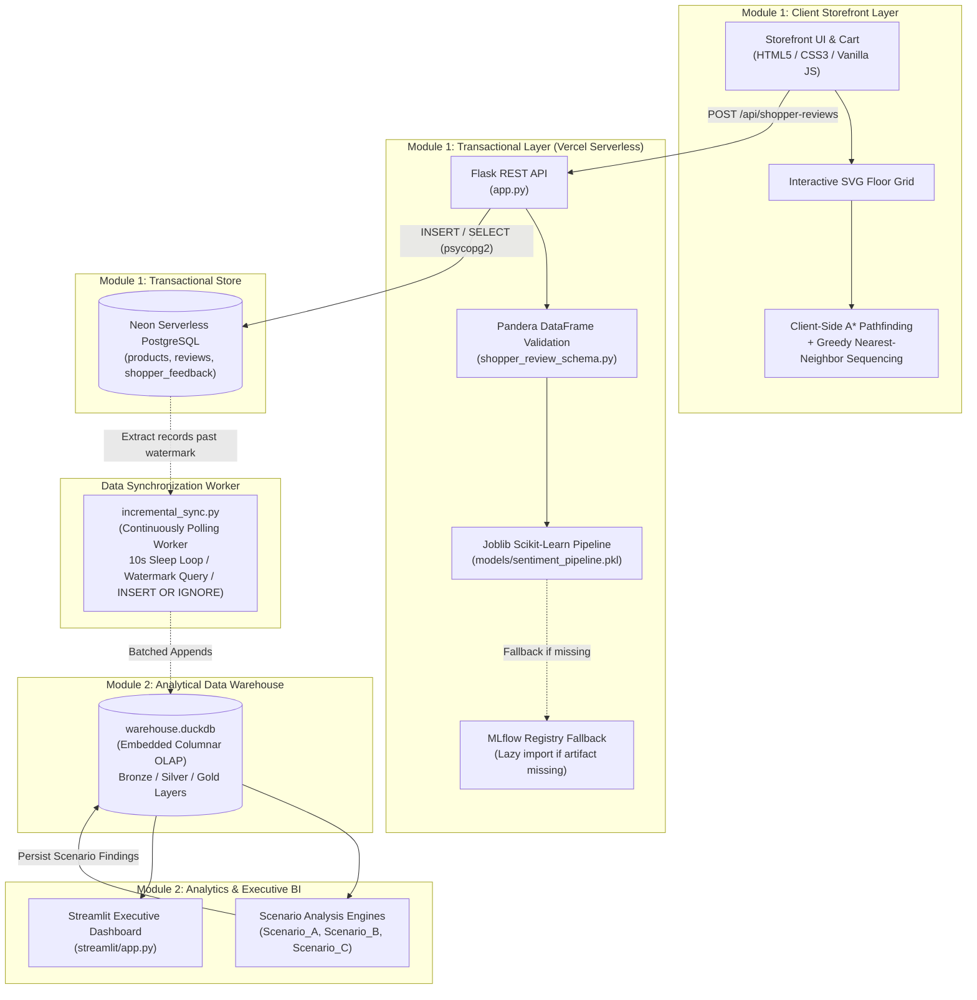
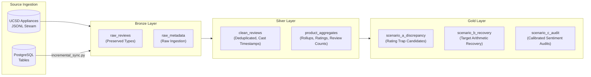
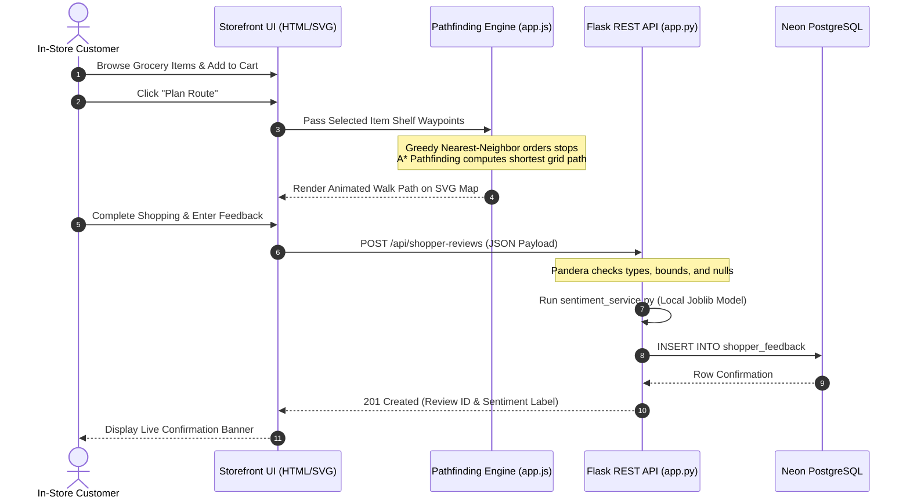

# Aislewise — Retail Product Intelligence & Analytics Platform

**Bridging Dynamic In-Store Navigation with Automated Review Forensics**

[](https://productreviewintelligence.vercel.app)
[](https://aislewise-2-4iv34qn38dgv3q7npfggyv.streamlit.app/)
[](https://www.python.org/)
[](https://neon.tech/)
[](https://duckdb.org/)
[](https://scikit-learn.org/)

---

## 1. Executive Summary & Problem Statement

Retail platforms face two distinct operational challenges across physical and digital customer touchpoints:

1. **Rating–Sentiment Divergence (Catalog Blindspots):** High average star ratings frequently obscure localized product defects, low sample sizes, or severe text-based complaints. Retailers lack automated mechanisms to triage deceptive products before customer trust degrades.
2. **In-Store Wayfinding Friction:** Physical supermarket shopping involves fragmented path planning and poor telemetry collection during checkout.

### The Aislewise Solution
Aislewise decouples operational transactional workflows from offline analytical investigations into two independent functional domains:

* **In-Store Grocery Navigation (OLTP):** A client-side, zero-build SVG storefront delivering browser-based A* pathfinding and greedy nearest-neighbor stop sequencing, streaming validated telemetry into a serverless PostgreSQL store.
* **Product Review Forensics (OLAP):** An analytical engine evaluating 50,000 Amazon Appliances reviews across a DuckDB Medallion warehouse, segmenting products into three actionable discrepancy scenarios (Rating Traps, Hidden Gems, Catalog Lemons) using calibrated NLP sentiment inference.

---

## 2. Live Deployments

| Component | Platform | Deployment URL | Role |
| :--- | :--- | :--- | :--- |
| **Live Storefront & Navigation** | Vercel Serverless | [productreviewintelligence.vercel.app](https://productreviewintelligence.vercel.app) | Interactive client grocery map, A* routing, cart telemetry |
| **Executive BI Analytics Suite** | Streamlit Community Cloud | [aislewise-2.streamlit.app](https://aislewise-2-4iv34qn38dgv3q7npfggyv.streamlit.app/) | Scenario drill-downs, distributions, and review auditing |
| **Source Code Repository** | GitHub | [Aislewise-2 Repository](https://github.com/poruri-santhosh/Aislewise-2) | Full source code, migrations, schemas, and pipelines |

> **Domain & Data Lifecycle Boundary:**  
> The **Storefront** simulates an in-store grocery environment running client-side A* pathfinding.  
> The **Analytics Dashboard** performs forensic evaluations over the **UCSD Amazon Reviews 2023 (Appliances category)** dataset.  
> These domains operate on independent data lifecycles. Amazon Appliances records do not populate the grocery storefront shelves, and submitted shopper feedback is not automatically replicated into DuckDB analytics without explicitly launching the incremental synchronization worker.

---

## 3. Key Business Findings & Forensic Scenarios

Analysis conducted over **50,000 ingested reviews** covering **15,641 unique parent ASINs** in the Amazon Appliances corpus:

| Scenario / Cohort | Selection Criteria | Product Count | Catalog Share | Business Interpretation & Recommended Remediation |
| :--- | :--- | :---: | :---: | :--- |
| **Scenario A: Rating Traps** | $\text{Stars} \ge 4.0 \;\land\; \text{NegShare} \ge 35\%$ | **440** | 2.81% | High aggregate star ratings masking severe customer complaints. *Action:* Trigger manual engineering & catalog audit. |
| **Scenario B: Hidden Gems** | $\text{Stars} \le 3.0 \;\land\; \text{PosShare} \ge 65\%$ | **174** | 1.11% | High-sentiment products suppressed by low sample sizes. *Action:* Solicit honest customer feedback coverage. |
| **Scenario C: Catalog Lemons** | $\text{Stars} \le 2.5 \;\land\; \text{NegShare} \ge 60\%$ | **1,481** | 9.47% | Chronic low quality with high negative alignment. *Action:* Prioritize for quality remediation or catalog de-listing. |
| **Nominal Catalog** | Balanced Rating & Sentiment | **13,546** | 86.61% | Standard commercial performance aligned with consumer expectations. |

### 3.1 Scenario A — Defect Complaint Taxonomy
An audited sample of **497 negative reviews** from **694 verified purchase customer records** highlights recurring defect signals:
* **Core Product Defect Reports:** 243 reviews (48.89%)
* **Size & Fitment Complaints:** 117 reviews (23.54%)
* **Material & Build Quality:** 103 reviews (20.72%)
* **Carrier & Packaging Logistics:** 34 reviews (6.84%)  
*(Note: Taxonomy categories are non-exclusive; individual reviews can match multiple keyword regex patterns. Figures reflect customer-reported defect signals rather than certified engineering failure audits).*

### 3.2 Scenario B — Target Rating Recovery Mathematics
Scenario B computes the deterministic minimum integer count of consecutive 5-star reviews ($\Delta R_5$) required to elevate an underperforming product's average rating to target threshold $T$ ($T < 5.0$):

$$\Delta R_5 = \max\left(0, \; \left\lceil \frac{T \cdot N - \sum_{i=1}^N r_i}{5 - T} \right\rceil\right)$$

* **Target Boundary Condition ($T = 5.0$):** At $T = 5.0$, the denominator evaluates to zero ($5 - 5 = 0$). An existing product with any review $r_i < 5$ cannot reach an exact average of $5.0$ through finite reviews ($\lim_{T \to 5^-} \Delta R_5 = \infty$).
* **Methodology Note:** This represents **deterministic arithmetic recovery** assuming every single additional review is strictly 5 stars. It is not probabilistic Bayesian updating, nor is it a recommendation to solicit biased reviews.

---

## 4. High-Level System Architecture



---

## 5. Technology Stack

| Layer | Technologies | Implementation Role |
| :--- | :--- | :--- |
| **Front-End & Wayfinding** | Vanilla HTML5, CSS3, JavaScript, SVG DOM | Coordinate layout, real-time cart state, zero-build client execution. |
| **Pathfinding Algorithms** | A* Graph Search, Greedy Nearest-Neighbor | In-browser aisle routing, coordinate waypoint traversal, order heuristic. |
| **Web & API Framework** | Python 3.12+, Flask 3.1, Gunicorn 23.0 | REST endpoints, JSON payload handling, serverless Lambda execution. |
| **Schema Validation** | Pandera 0.35 | Runtime DataFrame schema contract validation, bounds, and null checks. |
| **Transactional Database (OLTP)** | PostgreSQL (Neon Serverless), psycopg2-binary | Relational persistence, transactional safety, shopper feedback storage. |
| **Analytical Warehouse (OLAP)** | DuckDB 1.5 | In-process columnar processing, analytical SQL queries, scenario staging. |
| **Machine Learning & NLP** | scikit-learn 1.9, Joblib, TF-IDF Vectorizer | Logistic Regression classification, Platt confidence calibration. |
| **Experimentation & Tracking** | MLflow 3.18 | Offline model tracking, parameter logging, and registry fallback integration. |
| **Analytics Dashboard (BI)** | Streamlit 1.66, Plotly, Pandas | Metric filtering, forensic data drill-down, distribution visualizers. |

---

## 6. Deep Technical Specifications

<details>
<summary><strong>🔍 Click to expand: Data Engineering Lifecycle & Medallion Storage</strong></summary>

### Medallion Layering in DuckDB


### Incremental Synchronization Architecture (`incremental_sync.py`)
Synchronization between Neon PostgreSQL and DuckDB is implemented as a **manually launched, continuously polling worker**:
* **Polling Architecture:** Runs an explicit `while True` loop with a 10-second sleep (`time.sleep(10)`) when no new records are discovered.
* **Watermark Extraction:** Queries PostgreSQL using an updated timestamp watermark (`WHERE updated_at > %s ORDER BY updated_at ASC LIMIT %s`).
* **DuckDB Deduplication:** Executes batch appends utilizing `INSERT OR IGNORE INTO <table_name> VALUES (...)` against unique constraints.
* **Operational Scope:** On-demand synchronization; not an automated CDC pipeline or scheduled cron daemon.

```mermaid
flowchart TD
    subgraph Training_Phase ["Offline Model Lifecycle"]
        RawCorpus["Curated Review Text\n(Amazon Appliances Corpus)"]
        TFIDF["TF-IDF Vectorizer\n(ngram_range=(1,2), max_features=10000)"]
        Classifier["Logistic Regression\n(Binary: Positive vs Negative)"]
        Calibrator["CalibratedClassifierCV\n(Platt Scaling / Sigmoid Probabilities)"]
        MLflow["MLflow Experiment Tracking\n(Parameters, Metrics, Artifacts)"]
        JoblibExport["Joblib Serialization\n(models/sentiment_pipeline.pkl)"]

        RawCorpus --> TFIDF --> Classifier --> Calibrator
        Calibrator --> MLflow
        Calibrator --> JoblibExport
    end

    subgraph Runtime_Phase ["Inference Execution (sentiment_service.py)"]
        InboundText["Input Review String\n(API or Streamlit)"]
        ArtifactCheck{"models/sentiment_pipeline.pkl\nExists on Local Disk?"}
        LoadJoblib["joblib.load()\nFast In-Memory Scorer"]
        ImportMLflow["Lazy Import MLflow\nDownload from Model Registry"]
        EvaluateText{"Text Empty or\nLow Confidence?"}
        HeuristicFallback["Rating Heuristic Fallback\n(Star <= 2: Negative, Star >= 4: Positive)"]
        ModelOutput["Calibrated Sentiment & Score\n(Positive / Negative / Neutral)"]

        InboundText --> ArtifactCheck
        ArtifactCheck -->|Yes| LoadJoblib
        ArtifactCheck -->|No| ImportMLflow
        LoadJoblib --> EvaluateText
        ImportMLflow --> EvaluateText
        EvaluateText -->|Insufficient Features| HeuristicFallback
        EvaluateText -->|Valid Signal| ModelOutput
        HeuristicFallback --> ModelOutput
    end
```

</details>

<details>
<summary><strong>🤖 Click to expand: Machine Learning Lifecycle & Inference Guardrails</strong></summary>



* **Vercel Decoupling:** In production, `sentiment_service.py` deserializes the pre-packaged `models/sentiment_pipeline.pkl` via `joblib`. MLflow is only loaded on a dynamic fallback branch if the local artifact is missing, ensuring the deployment bundle remains under Vercel's 500 MB limit.
* **Heuristic Fallback:** When review text lacks vocabulary features or contains non-standard text, the service applies an empirical rating boundary heuristic ($Rating \le 2 \implies Negative$; $Rating \ge 4 \implies Positive$; $Rating = 3 \implies Neutral$).
</details>

<details>
<summary><strong>🧭 Click to expand: In-Store Navigation & Heuristics</strong></summary>

The storefront provides an interactive coordinate map rendered via client-side SVG.



### Heuristic Specifications
1. **A\* Grid Traversal:** Traverses a 2D coordinate graph with obstacles corresponding to store shelves and checkout counters using Euclidean distance:
   $$h(n) = \sqrt{(x_n - x_{\text{goal}})^2 + (y_n - y_{\text{goal}})^2}$$
2. **Nearest-Neighbor Sequencing:** Multi-item cart stops are ordered using a greedy nearest-neighbor heuristic to sequence waypoints. *Clarification: This is a fast polynomial-time heuristic designed for low-latency client execution, not a globally optimal Traveling Salesperson Problem (TSP) solver.*
</details>

---

## 7. Local Installation & Development Setup

### Prerequisites
* Python 3.12 or newer
* Accessible PostgreSQL instance (Local or Neon Serverless)
* Git

```bash
# 1. Clone repository & create virtual environment
git clone https://github.com/poruri-santhosh/Aislewise-2.git
cd Aislewise-2

python -m venv .venv
# On Windows PowerShell:
.venv\Scripts\Activate.ps1
# On Linux / macOS:
source .venv/bin/activate

# 2. Install dependencies
python -m pip install --upgrade pip setuptools wheel
python -m pip install -r requirements.txt
python -m pip install -r requirements-analysis.txt -r requirements-dev.txt -r streamlit/requirements.txt

# 3. Configure environment variables in .env
# DATABASE_URL="postgresql://<USER>:<PASSWORD>@<HOST>:5432/<DATABASE>?sslmode=require"
# NEON_DATABASE_URL="postgresql://<USER>:<PASSWORD>@<HOST>:5432/<DATABASE>?sslmode=require"
# AISLEWISE_WAREHOUSE_PATH="warehouse.duckdb"
# FLASK_SECRET_KEY="your-secret-key"

# 4. Run database migration
python -c "import psycopg2, os; from dotenv import load_dotenv; load_dotenv(); conn = psycopg2.connect(os.getenv('DATABASE_URL') or os.getenv('NEON_DATABASE_URL')); cur = conn.cursor(); cur.execute(open('migrations/001_create_shopper_feedback.sql').read()); conn.commit(); cur.close(); conn.close(); print('Database schema initialized successfully.')"

# 5. Start Flask Storefront
python app.py  # Accessible at http://127.0.0.1:5000

# 6. Start Streamlit Dashboard (in a separate terminal)
python -m streamlit run streamlit/app.py  # Accessible at http://localhost:8501
```

---

## 8. Pipeline Execution Workflows

Execute offline extraction, database population, and analytical transformations in sequence:

```bash
# Step 1: Download & parse UCSD Appliances dataset
python dataset_generation.py

# Step 2: Ingest catalog and reviews into PostgreSQL
python load_to_postgres.py

# Step 3: Ingest raw records into DuckDB staging warehouse
python ingest_to_duckdb.py

# Step 4: Launch the continuous polling incremental sync worker
# (Polls PostgreSQL for updates past watermark; run until terminated with Ctrl+C)
python incremental_sync.py

# Step 5: Execute forensic scenario scripts
python Scenario_A/scenario_a_trap_products.py
python Scenario_B/scenario_b_base_detection.py
python Scenario_B/scenario_b_deep_forensics.py
python Scenario_C/scenario_c_audit.py
```

---

## 9. API Reference & Contract Validation

<details>
<summary><strong>📡 Click to expand: Endpoints & Request/Response Contracts</strong></summary>

### Contract Validation (`shopper_review_schema.py`)
Incoming payloads to `/api/shopper-reviews` are converted to single-row DataFrames and validated against `ShopperReviewSchema`:
* `customer_name`: String $\in [1, 128]$ characters.
* `rating`: Integer strictly bounded between $1$ and $5$.
* `review_text`: String, maximum $5,000$ characters.
* `dwell_time_seconds`: Float, minimum $0.0$.
* `cart_items`: Python list of string identifiers.

*(Note: Response examples below utilize illustrative synthetic test telemetry for demonstration purposes).*

#### 1. System Health Check
* **Endpoint:** `GET /health`
* **Response (200 OK):**
  ```json
  {
    "status": "healthy",
    "database": "connected"
  }
  ```

#### 2. Catalog Metrics Summary
* **Endpoint:** `GET /api/summary`
* **Response (200 OK):**
  ```json
  {
    "total_products": 15641,
    "total_reviews": 50000,
    "average_rating": 4.21
  }
  ```

#### 3. Paginated Reviews Query
* **Endpoint:** `GET /api/reviews?page=1&page_size=2`
* **Response (200 OK):**
  ```json
  {
    "page": 1,
    "page_size": 2,
    "total_records": 50000,
    "reviews": [
      {
        "review_id": "rev_1",
        "product_id": "B00004SQ0A",
        "rating": 5,
        "review_text": "Works as intended. Reliable replacement part.",
        "verified_purchase": true,
        "created_at": "2023-01-15T08:30:00Z"
      },
      {
        "review_id": "rev_2",
        "product_id": "B00004SQ0A",
        "rating": 2,
        "review_text": "Broke during installation. Very fragile plastic.",
        "verified_purchase": true,
        "created_at": "2023-02-10T14:12:00Z"
      }
    ]
  }
  ```

#### 4. Submit Shopper Feedback
* **Endpoint:** `POST /api/shopper-reviews`
* **Request Payload:**
  ```json
  {
    "customer_name": "Sample Shopper",
    "rating": 5,
    "review_text": "Navigated store aisles effortlessly, found all items.",
    "dwell_time_seconds": 184.5,
    "cart_items": ["item_milk", "item_bread"]
  }
  ```
* **Response (201 Created):**
  ```json
  {
    "status": "success",
    "feedback_id": 1,
    "customer_name": "Sample Shopper",
    "sentiment": "Positive",
    "sentiment_score": 0.9412,
    "message": "Shopper feedback successfully validated and recorded."
  }
  ```
</details>

---

## 10. Automated Testing

```bash
# Run automated test suite
python -m pytest -q
```

* **`tests/test_app.py`:** Tests Flask endpoints, routing, error handling, and database fallbacks.
* **`tests/test_shopper_flow.py`:** Validates Pandera contract enforcement, rejecting invalid ratings ($<1$ or $>5$), negative dwell times, and invalid cart item formats.

---

## 11. Production Deployment

### Vercel Serverless (Storefront & Flask API)
1. Link repository to Vercel with the project root set to repository root.
2. Configure environment variables in Vercel project settings: `DATABASE_URL` / `NEON_DATABASE_URL` and `FLASK_SECRET_KEY`.
3. Bundle Optimization: Root `requirements.txt` is kept minimal; heavy data packages (`mlflow`, `streamlit`, `duckdb`) are excluded to strictly honor the 500 MB Lambda limit.
4. Entrypoint: `api/index.py` delegates execution to `app.py`.

### Streamlit Community Cloud (Analytics Dashboard)
1. Link repository to Streamlit Community Cloud, targeting `streamlit/app.py`.
2. Configure dependencies through `streamlit/requirements.txt`.
3. Ensure `warehouse.duckdb` is present in the deployment root.

---

## 12. Repository Topology

```
Aislewise-2/
├── api/                         # Vercel serverless routing entry point
│   └── index.py
├── migrations/                  # Database migration DDL
│   └── 001_create_shopper_feedback.sql
├── models/                      # Deserialized scikit-learn models (joblib)
│   └── sentiment_pipeline.pkl
├── public/static/               # Vanilla JS navigation engines & styles
│   ├── app.js                   # Client-side A* pathfinding & cart telemetry
│   └── styles.css
├── Scenario_A/                  # Discrepancy detection scripts & outputs
│   └── scenario_a_trap_products.py
├── Scenario_B/                  # Rating recovery arithmetic & forensics
│   ├── scenario_b_base_detection.py
│   └── scenario_b_deep_forensics.py
├── Scenario_C/                  # Semantic NLP audit scripts & models
│   └── scenario_c_audit.py
├── streamlit/                   # Streamlit analytics application
│   ├── app.py                   # Executive dashboard layout and visualizers
│   └── requirements.txt         # Isolated analytics dependencies
├── templates/                   # Frontend markup templates (Jinja2)
│   └── index.html
├── tests/                       # Unit and integration test suites
│   ├── test_app.py
│   └── test_shopper_flow.py
├── app.py                       # Main Flask web application & REST API
├── shopper_review_schema.py     # Pandera payload validation contract
├── sentiment_service.py         # Model loading and prediction interface
├── dataset_generation.py        # Streamed HTTP extractor for UCSD dataset
├── load_to_postgres.py          # PostgreSQL batch catalog and review loader
├── ingest_to_duckdb.py          # Staging Bronze loader for DuckDB
├── incremental_sync.py          # Continuous polling incremental sync worker
├── warehouse.duckdb             # Local OLAP analytics snapshot
├── requirements.txt             # Web production dependencies (Vercel)
├── requirements-analysis.txt    # Data processing & scenario dependencies
├── requirements-dev.txt         # Testing and development tooling
├── vercel.json                  # Serverless function runtime config
└── .vercelignore                # Deployment bundle exclusion rules
```

---

## 13. Author & Acknowledgements

**Poruri Jayakara Santhosh Vardhan**  
Specialization: AI/Machine Learning & Full-Stack Systems Engineering  
* **GitHub:** [@poruri-santhosh](https://github.com/poruri-santhosh)  
* **Project Repository:** [Aislewise-2](https://github.com/poruri-santhosh/Aislewise-2)

### Acknowledgements
* Amazon Reviews 2023 dataset by Julian McAuley Lab, University of California San Diego.
* Open-source Python, PostgreSQL, DuckDB, scikit-learn, Flask, and Streamlit communities.

### License
This project is licensed under the Apache License 2.0. See the [LICENSE](LICENSE) file for details.